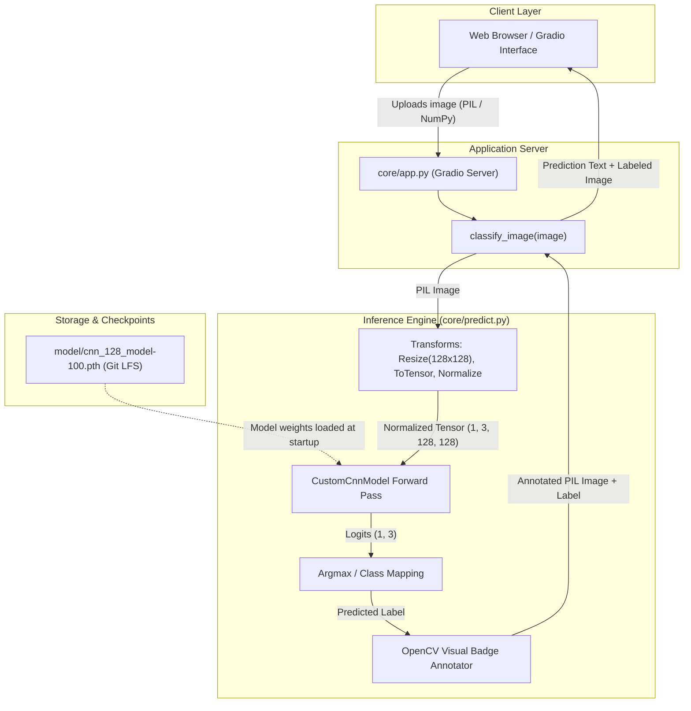
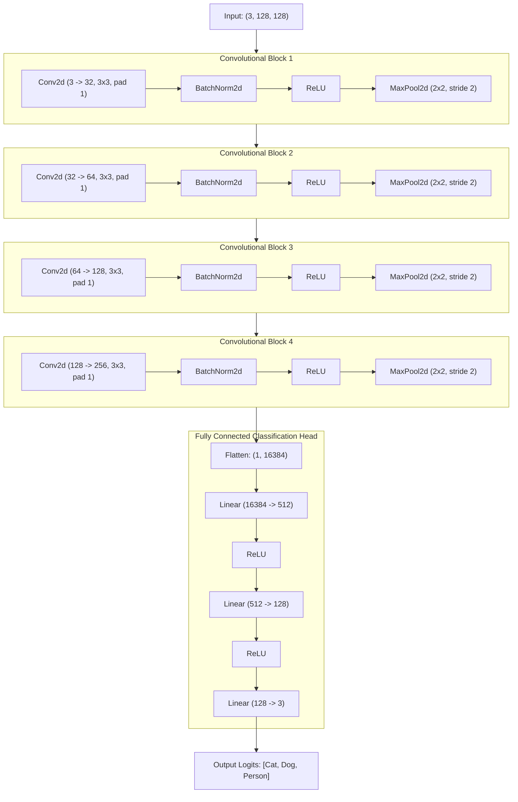

# Image Classification App

[](https://www.python.org/)
[](https://pytorch.org/)
[](https://gradio.app/)
[](https://opensource.org/licenses/MIT)

An interactive computer vision application built with PyTorch and Gradio for multi-class image classification. The application evaluates input images and predicts categorical probabilities across three target classes: **Cat**, **Dog**, and **Person**.

---

## Table of Contents

- [Overview](#overview)
- [System Architecture](#system-architecture)
- [Neural Network Architecture](#neural-network-architecture)
- [Core Features](#core-features)
- [Repository Structure](#repository-structure)
- [Installation and Setup](#installation-and-setup)
  - [Prerequisites](#prerequisites)
  - [Environment Configuration](#environment-configuration)
  - [Dependencies](#dependencies)
- [Usage](#usage)
  - [Local Execution](#local-execution)
  - [Public URL Generation](#public-url-generation)
- [Deployment](#deployment)
  - [Hugging Face Spaces](#hugging-face-spaces)
- [API Reference](#api-reference)
- [Troubleshooting](#troubleshooting)
- [License](#license)

---

## Overview

The Image Classification App provides a web-based inference interface designed for rapid prototyping and deployment of deep learning models. Users can supply images through local file upload or webcam capture. The processing pipeline transforms the input image, feeds it through a custom Convolutional Neural Network (CNN) trained in PyTorch, extracts categorical predictions, and overlays visual labels directly onto the rendered result.

---

## System Architecture

The following diagram outlines the end-to-end data lifecycle from user interaction to visual output:



---

## Neural Network Architecture

The classification backbone (`CustomCnnModel`) consists of four sequential convolutional blocks for feature extraction followed by a multi-layer perceptron (MLP) classification head:



### Layer Specification

| Stage | Layer Configuration | Activation | Output Dimensions |
| :--- | :--- | :--- | :--- |
| **Input** | RGB Image Tensor | Normalized (mean=0.5, std=0.5) | `(3, 128, 128)` |
| **Block 1** | Conv2d (3 $\to$ 32, $3\times3$) + BatchNorm | ReLU + MaxPool2d($2\times2$) | `(32, 64, 64)` |
| **Block 2** | Conv2d (32 $\to$ 64, $3\times3$) + BatchNorm | ReLU + MaxPool2d($2\times2$) | `(64, 32, 32)` |
| **Block 3** | Conv2d (64 $\to$ 128, $3\times3$) + BatchNorm | ReLU + MaxPool2d($2\times2$) | `(128, 16, 16)` |
| **Block 4** | Conv2d (128 $\to$ 256, $3\times3$) + BatchNorm | ReLU + MaxPool2d($2\times2$) | `(256, 8, 8)` |
| **Flatten** | Spatial Flattening | - | `(16384)` |
| **Dense 1** | Linear ($16384 \to 512$) | ReLU | `(512)` |
| **Dense 2** | Linear ($512 \to 128$) | ReLU | `(128)` |
| **Output** | Linear ($128 \to 3$) | Categorical Logits | `(3)` |

### Target Classes

- Index `0`: **Cat**
- Index `1`: **Dog**
- Index `2`: **Person**

---

## Core Features

- **In-Memory Inference**: Eliminates disk read/write cycles by streaming image arrays in memory between Gradio, PyTorch, and OpenCV.
- **Hardware Acceleration Support**: Automatically detects and leverages CUDA GPUs when available; supports CPU execution and Hugging Face ZeroGPU runtime environments.
- **Robust Input Handling**: Accommodates variable image dimensions, orientations, and formats with automated preprocessing and null checks.
- **Git LFS Model Management**: Employs Git Large File Storage (LFS) to maintain repository integrity without bloating version control history.

---

## Repository Structure

```
Simple_gradio_app/
├── .gitattributes             # Git LFS specifications for model checkpoints
├── .gitignore                 # Exclusion rules for build artifacts and caches
├── README.md                  # Technical documentation
├── requirements.txt           # Top-level dependencies
├── core/
│   ├── app.py                 # Gradio interface definition and runtime entry
│   ├── predict.py             # Neural network model and inference pipeline
│   └── requirements.txt       # Module dependencies
└── model/
    ├── __init__.py            # Model module initialization
    └── cnn_128_model-100.pth  # Trained PyTorch model checkpoint (Git LFS)
```

---

## Installation and Setup

### Prerequisites

- Python 3.10, 3.11, or 3.12
- Git with [Git LFS](https://git-lfs.github.com/) installed

### Environment Configuration

1. **Clone the repository**:
   ```bash
   git clone https://github.com/nishnarudkar/Simple_gradio_app.git
   cd Simple_gradio_app
   ```

2. **Pull binary model weights**:
   ```bash
   git lfs install
   git lfs pull
   ```

3. **Initialize virtual environment**:
   ```bash
   # Linux / macOS
   python3 -m venv venv
   source venv/bin/activate

   # Windows
   python -m venv venv
   venv\Scripts\activate
   ```

### Dependencies

Install the required packages using the top-level requirements file:

```bash
pip install --upgrade pip
pip install -r requirements.txt
```

---

## Usage

### Local Execution

Launch the Gradio application from the root directory:

```bash
python core/app.py
```

Upon startup, the local server will be accessible at:
```
http://127.0.0.1:7860
```

### Public URL Generation

To expose a shareable link via Gradio's reverse proxy, modify `core/app.py`:

```python
if __name__ == "__main__":
    demo.launch(share=True)
```

---

## Deployment

### Hugging Face Spaces

The project is structured to deploy to Hugging Face Spaces with minimal configuration:

1. Create a Space on Hugging Face using the **Gradio** SDK.
2. Add the Hugging Face remote repository:
   ```bash
   git remote add space https://huggingface.co/spaces/<username>/<space-name>
   git push space main
   ```
3. The codebase contains conditional imports for `spaces` and decorators (`@spaces.GPU`) to ensure operational compatibility with both standard CPU instances and dynamic ZeroGPU environments.

---

## API Reference

The classification logic is exposed via `ImageClassifier` in `core/predict.py`:

```python
from predict import ImageClassifier
from PIL import Image

# Initialize classifier with checkpoint path
classifier = ImageClassifier(model_path="model/cnn_128_model-100.pth")

# Run prediction
input_image = Image.open("sample.jpg")
label, annotated_image = classifier.predict(input_image)

print(f"Predicted Class: {label}")
```

### Methods

#### `ImageClassifier.predict(image_input)`
- **Parameters**: `image_input` (*str | PIL.Image.Image | numpy.ndarray*) - File path or in-memory image object.
- **Returns**: `tuple(label: str, annotated_image: PIL.Image.Image | str)` - Name of predicted class and the visually annotated image.

---

## Troubleshooting

### Model Checkpoint Not Found
- Verify that Git LFS has downloaded the actual binary file rather than the pointer:
  ```bash
  git lfs pull
  ```
- Ensure `model/cnn_128_model-100.pth` is approximately 35 MB in size.

### Headless Server OpenCV Initialization
- If deploying on a headless Linux environment, ensure `opencv-python-headless` is installed rather than `opencv-python` to prevent missing X11/OpenGL (`libGL.so.1`) runtime errors.

---

## License

This project is licensed under the MIT License. See the [LICENSE](LICENSE) file for complete terms.
