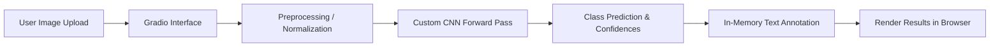

# 🐾 Image Classification App

[](https://www.python.org/)
[](https://pytorch.org/)
[](https://gradio.app/)
[](https://opensource.org/licenses/MIT)
[](https://huggingface.co/spaces/Phoenixnaru/classification-gradio)

An interactive, deep learning-powered web application built with **PyTorch** and **Gradio** that classifies images in real-time into three classes: **Cat**, **Dog**, or **Person**.

---

## 📌 Table of Contents

- [Overview](#-overview)
- [System Architecture](#-system-architecture)
- [Key Features](#-key-features)
- [Model Details](#-model-details)
- [Project Structure](#-project-structure)
- [Getting Started](#-getting-started)
  - [Prerequisites](#prerequisites)
  - [Installation](#installation)
  - [Running the App](#running-the-app)
- [Deployment](#-deployment)
  - [Hugging Face Spaces](#deploying-to-hugging-face-spaces)
- [API Reference](#-api-reference)
- [Troubleshooting](#-troubleshooting)
- [License](#-license)

---

## 🌟 Overview

The **Image Classification App** provides a user-friendly browser interface for instant computer vision inference. Users can upload any photo or capture an image via webcam to detect whether the subject is a **Cat**, **Dog**, or **Person**. 

The app performs end-to-end inference using a custom multi-layer Convolutional Neural Network (CNN) trained with PyTorch, automatically labels the image with bounding text annotations, and displays both the prediction and the annotated visual result.

---

## 🏗 System Architecture



---

## ✨ Key Features

- **End-to-End Deep Learning**: Powered by a custom 4-stage convolutional backbone with Batch Normalization and dynamic linear layer mapping.
- **Real-Time Interactive UI**: Built with Gradio for clean, responsive drag-and-drop image uploads and webcam support.
- **In-Memory Zero-Disk Inference**: Eliminates disk I/O bottlenecks and temporary file collisions during concurrent requests.
- **ZeroGPU & Accelerator Compatibility**: Seamless dynamic hardware detection—runs out-of-the-box on CPU, local CUDA GPUs, and Hugging Face ZeroGPU.
- **Automated Visual Labeling**: Overlays clear high-contrast predicted label badges onto the uploaded image.
- **Large Model Tracking**: Git LFS enabled for reliable tracking of PyTorch weights (`*.pth`).

---

## 🧠 Model Details

The classifier utilizes `CustomCnnModel`, a custom Convolutional Neural Network trained to classify $128 \times 128$ RGB images:

| Layer Stage | Details | Activation / Pooling | Output Shape |
| :--- | :--- | :--- | :--- |
| **Input** | RGB Image | Normalized $[-1, 1]$ | `(3, 128, 128)` |
| **Conv Block 1** | Conv2d (3 $\to$ 32, $3\times3$, pad 1) + BatchNorm2d | ReLU + MaxPool2d($2\times2$) | `(32, 64, 64)` |
| **Conv Block 2** | Conv2d (32 $\to$ 64, $3\times3$, pad 1) + BatchNorm2d | ReLU + MaxPool2d($2\times2$) | `(64, 32, 32)` |
| **Conv Block 3** | Conv2d (64 $\to$ 128, $3\times3$, pad 1) + BatchNorm2d | ReLU + MaxPool2d($2\times2$) | `(128, 16, 16)` |
| **Conv Block 4** | Conv2d (128 $\to$ 256, $3\times3$, pad 1) + BatchNorm2d | ReLU + MaxPool2d($2\times2$) | `(256, 8, 8)` |
| **Dense 1** | Linear ($16384 \to 512$) | ReLU | `(512)` |
| **Dense 2** | Linear ($512 \to 128$) | ReLU | `(128)` |
| **Output** | Linear ($128 \to 3$) | Logits $\to$ Argmax | `(3)` |

### Classes:
- `0`: **Cat**
- `1`: **Dog**
- `2`: **Person**

---

## 📁 Project Structure

```
Simple_gradio_app/
├── .gitattributes             # Git LFS configuration for *.pth weights
├── .gitignore                 # Cache and temporary file exclusions
├── requirements.txt           # Top-level dependencies
├── README.md                  # Project documentation
├── core/
│   ├── app.py                 # Gradio user interface application
│   ├── predict.py             # Model definition and ImageClassifier pipeline
│   └── requirements.txt       # Core package dependencies
└── model/
    └── cnn_128_model-100.pth  # Trained PyTorch model checkpoint (Git LFS)
```

---

## 🚀 Getting Started

### Prerequisites

- **Python**: Version 3.10, 3.11, or 3.12
- **Git & Git LFS**: Ensure [Git LFS](https://git-lfs.github.com/) is installed to download the model checkpoint:
  ```bash
  git lfs install
  ```

### Installation

1. **Clone the repository**:
   ```bash
   git clone https://github.com/nishnarudkar/Simple_gradio_app.git
   cd Simple_gradio_app
   ```

2. **Pull Git LFS weights**:
   ```bash
   git lfs pull
   ```

3. **Create and activate a virtual environment**:
   ```bash
   # On macOS/Linux
   python3 -m venv venv
   source venv/bin/activate

   # On Windows
   python -m venv venv
   venv\Scripts\activate
   ```

4. **Install dependencies**:
   ```bash
   pip install --upgrade pip
   pip install -r requirements.txt
   ```

### Running the App

Launch the application:

```bash
python core/app.py
```

Once started, open your web browser and navigate to:
```
http://127.0.0.1:7860
```

To create a shareable public URL via Gradio tunnel, set `share=True` in `app.py`:
```python
demo.launch(share=True)
```

---

## 🌐 Deployment

### Deploying to Hugging Face Spaces

1. Create a new Space on [Hugging Face](https://huggingface.co/new-space) using the **Gradio** SDK.
2. Link your local repository to the Hugging Face remote:
   ```bash
   git remote add space https://huggingface.co/spaces/<your-username>/<your-space-name>
   git push space main
   ```
3. The application is pre-configured with `@spaces.GPU` and dynamic fallbacks, supporting both free CPU instances and ZeroGPU hardware.

---

## 💻 API Reference

### `ImageClassifier`

Located in `core/predict.py`:

```python
from predict import ImageClassifier
from PIL import Image

# Initialize the classifier
classifier = ImageClassifier(model_path="model/cnn_128_model-100.pth")

# Predict using a PIL image or file path
image = Image.open("sample.jpg")
label, annotated_image = classifier.predict(image)

print(f"Predicted class: {label}")
```

---

## 🛠 Troubleshooting

<details>
<summary><b>1. FileNotFoundError: Model file not found</b></summary>

Ensure you have run `git lfs pull` after cloning so the binary `.pth` checkpoint is fetched instead of the Git LFS pointer file.
</details>

<details>
<summary><b>2. OpenCV libGL.so.1 error in Linux/Docker</b></summary>

The project uses `opencv-python-headless` in `requirements.txt` to avoid missing graphical X11/OpenGL dependencies on headless systems.
</details>

<details>
<summary><b>3. Hugging Face ZeroGPU CUDA Error</b></summary>

`spaces` must be imported at line 1 before `torch`. `app.py` is configured with a safe `try-except` block to ensure compatibility both locally and on ZeroGPU.
</details>

---

## 📄 License

This project is licensed under the MIT License. See [LICENSE](LICENSE) for details.
